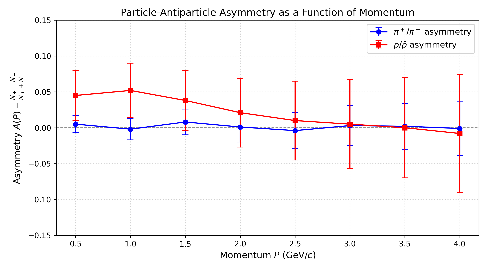

# Simulating Particle Production by a Collision in Particle Physics

This project performs statistical analysis on 11 large given text files that include information from 5 million pp collisions at $\sqrt{s}$ = 14 TeV across **11 sub-samples** (~770 MB per file). The goal is to determine the average yield of particles per event alongside their statistical uncertainties using the **sub-sampling method**. 

## Student Information
Maya Chanda \
i6393996

## Questions to be Answered:

* What are the average counts of each particle species and their statistical uncertainties?
* Is there any asymmetry between the particle and the anti-particle?
* Is there any asymmetry as a function of their momentum?
  
Where possible, these questions are answered quantitatively rather than qualitatively.

## Methodology: Sub-Sampling Technique
To calculate the central values and statistical uncertainties without relying on error propagation across correlated variables, we apply sub-sampling:

   1. **Sub-Sample Values:** Each sub-sample $i$ is analysed independently to compute two quantities:
      * the yield per event, $x_i = N_{\text{count},i} / N_{\text{events},i}$
      * the particle/anti-particle asymmetry, $A_i = \dfrac{N^+_i - N^-_i}{N^+_i + N^-_i}$.

   $A = 0$ means equal numbers, and $A > 0$ means more particles than anti-particles.

2. **Central Value (Mean):** The overall mean $\mu$ across all $N = 11$ sub-samples is calculated as:
   $$\mu = \frac{1}{N} \sum_{i=1}^{N} \bar{x}_i$$

3. **Statistical Uncertainty:** The standard error of the mean across the sub-samples provides the statistical uncertainty:
   $$\sigma_{\text{stat}} = \frac{s}{\sqrt{N}} = \sqrt{\frac{1}{N(N-1)} \sum_{i=1}^{N} (x_i - \mu)^2}$$

4. **Significance:** $|\mu_A| / \sigma_A$, the number of standard deviations an asymmetry lies from zero. Below 3σ is treated as consistent with zero, 3–5σ as evidence, and above 5σ as a clear observation.

5. **Momentum dependence:** The momentum is $p = \sqrt{p_x^2 + p_y^2 + p_z^2}$. Particles are sorted into 10 bins (0–0.25, 0.25–0.5, 0.5–0.75, 0.75–1, 1–1.5, 1.5–2, 2–3, 3–5, 5–10 and above 10 GeV/c), and the asymmetry in each bin is found with the same sub-sampling method. A bin is only used if it has at least 10 particles plus anti-particles per sub-sample on average. To test whether the asymmetry changes with momentum, the bins are compared with the mean asymmetry using $\chi^2 = \sum_{\text{bins}} \left(\frac{A_{\text{bin}} - \mu_A}{\sigma_{A,\text{bin}}}\right)^2$ with $n_{\text{bins}} - 1$ degrees of freedom. A p-value below 0.01 means the asymmetry is unlikely to be constant.

## Results

### Average yields per event

| Particle ID | Particle Name | Total Count | Central Value (Mean / Event) | Statistical Uncertainty ($\pm \sigma_{\text{stat}}$) |
| :---: | :---: | :---: | :---: | :---: |
| `211` | $\pi^+$ | 9,195,843 | 18.392 | $\pm$ 0.032 |
| `-211` | $\pi^-$ | 9,185,115 | 18.370 | $\pm$ 0.032 |
| `321` | $K^+$ | 1,158,009 | 2.3160 | $\pm$ 0.0039 |
| `-321` | $K^-$ | 1,152,903 | 2.3058 | $\pm$ 0.0043 |
| `2212` | Proton ($p$) | 556,883 | 1.1138 | $\pm$ 0.0021 |
| `-2212` | Anti-proton ($\bar{p}$) | 545,573 | 1.0911 | $\pm$ 0.0025 |
| `3122` | $\Lambda$ | 127,059 | 0.25412 | $\pm$ 0.00047 |
| `-3122` | $\bar{\Lambda}$ | 124,773 | 0.24955 | $\pm$ 0.00071 |
| `3312` | $\Xi^-$ | 18,166 | 0.03633 | $\pm$ 0.00028 |
| `-3312` | $\Xi^+$ | 18,079 | 0.03616 | $\pm$ 0.00034 |
| `3334` | $\Omega^-$ | 555 | 0.001110 | $\pm$ 0.000042 |
| `-3334` | $\Omega^+$ | 513 | 0.001026 | $\pm$ 0.000051 |

### Mean asymmetry

| Species | Particles − anti-particles | Asymmetry $A$ | Significance |
| :---: | :---: | :---: | :---: |
| $\pi^+$ / $\pi^-$ | +10,728 | 0.00058 ± 0.00010 | 5.7σ |
| $K^+$ / $K^-$ | +5,106 | 0.00221 ± 0.00037 | 5.9σ |
| $p$ / $\bar{p}$ | +11,310 | 0.01027 ± 0.00088 | 11.6σ |
| $\Lambda$ / $\bar{\Lambda}$ | +2,286 | 0.0091 ± 0.0015 | 6.2σ |
| $\Xi^-$ / $\Xi^+$ | +87 | 0.0025 ± 0.0054 | 0.5σ |
| $\Omega^-$ / $\Omega^+$ | +42 | 0.044 ± 0.036 | 1.2σ |

### Why sub-sampling matters

A tempting shortcut is to compare the two yields directly. For pions the difference is $18.392 - 18.370 = 0.022$ per event, and combining the uncertainties as if they were independent gives $\sqrt{0.032^2 + 0.032^2} = 0.045$. That makes the difference look like only 0.5σ, or no asymmetry at all.

This is wrong, because $N^+$ and $N^-$ are **strongly correlated**. Charge is conserved in every collision, so an event that produces many $\pi^+$ also tends to produce many $\pi^-$. Their difference therefore fluctuates much less than each count does on its own. Calculating $A$ inside each sub-sample keeps this correlation, and gives an uncertainty about 2.3 times smaller than the independent-Poisson estimate ($\sigma_A$ = 0.00023). The pion asymmetry then turns out to be significant.

### Asymmetry as a function of momentum

*Asymmetry in each momentum bin, with 1σ statistical error bars from sub-sampling. The grey line marks zero asymmetry and the dashed line the mean asymmetry. Empty momentum bins had too few entries to use (see Methodology, point 5).*

| Species | χ² / ndf | p-value | Constant in momentum? |
| :---: | :---: | :---: | :---: |
| $\pi^+$ / $\pi^-$ | 13.7 / 9 | 0.13 | Consistent |
| $K^+$ / $K^-$ | 41.9 / 9 | 0.000003 | **No**, rises above 5 GeV/c |
| $p$ / $\bar{p}$ | 22.8 / 9 | 0.007 | **No**, larger above 5 GeV/c |
| $\Lambda$ / $\bar{\Lambda}$ | 7.6 / 9 | 0.58 | Consistent |
| $\Xi^-$ / $\Xi^+$ | 13.4 / 8 | 0.10 | Consistent |
| $\Omega^-$ / $\Omega^+$ | 0.5 / 1 | 0.49 | Too few entries to test (only 2 usable bins) |

  

## Conclusion

**Particle/anti-particle asymmetry:** Four of the six species show a significant excess of particles over anti-particles: protons ($A$ = 0.01027 ± 0.00088, 11.6σ), Λ (6.2σ), kaons (5.9σ) and pions (5.7σ). Ξ and Ω are consistent with zero, but have too few entries to see an effect of this size. The asymmetry is largest for baryons, which fits the initial state: the colliding protons carry a baryon number of +2 and no anti-baryons.

**Momentum dependence:** For kaons and protons the asymmetry increases above 5 GeV/c (χ² p-values 0.000003 and 0.007). For pions, Λ and Ξ it is consistent with being constant in momentum.

**Limitations:** Only statistical uncertainties are included, and only one file of 500,000 events was analysed. With 20 sub-samples, each uncertainty is itself known only to about 16%, so a significance of 5.7σ should be read as roughly 5–7σ.
